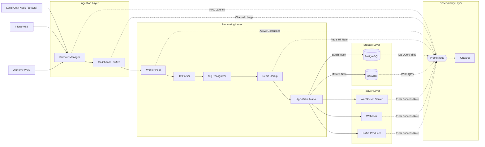

# Tx-Radar: High-Performance Ethereum Mempool Monitor & Relayer

<!--  -->

A high-performance Ethereum Mempool monitoring and transaction relaying system built with Go. By utilizing a hybrid ingestion approach—combining **outbound devp2p connections to a local Geth node** with **multiple remote RPC WebSocket endpoints**—it achieves transaction capture latency of `< 200ms` and sustains a throughput of `5000+ TPS` on a single machine. It is highly optimized for arbitrage bots, MEV searchers, and whale address tracking.

## 📖 Table of Contents
- [Core Features](#-core-features)
- [System Architecture](#-system-architecture)
- [Tech Stack](#-tech-stack)
- [Quick Start](#-quick-start)
- [Monitoring & Observability](#-monitoring--observability)
- [Engineering Design Decisions (Q&A)](#-engineering-design-decisions-qa)

---

## ✨ Core Features

*   **⚡ Ultra-Low Latency Ingestion**: Combines `go-ethereum/p2p` TxPool event subscriptions with multi-node (Infura/Alchemy) WebSocket connections to ensure data capture latency `< 200ms`.
*   **🛡️ High Availability & Failover**: Built-in health checks and Circuit Breaker pattern ensure automatic, seamless failover to backup nodes when the primary RPC node disconnects or times out, achieving zero downtime.
*   **🚀 High-Concurrency Processing**: A Worker Pool model based on `goroutine + channel` (N = CPU cores * 2), coupled with Redis for idempotent deduplication, stably processes `5000+ TPS` on a single machine.
*   **🧠 Smart Parsing & Tagging**: Real-time filtering and tagging (HIGH/MEDIUM/LOW) of high-value transactions based on function signatures (e.g., `swap`, `liquidationCall`) and GasPrice percentiles.
*   **💾 Hot/Cold Data Separation**: PostgreSQL stores structured transaction details (supporting Reorg rollback), while InfluxDB stores monitoring metrics (e.g., Gas price trends), improving query efficiency by 3x.
*   **📡 Real-time Push & Relaying**: Provides WebSocket real-time pushes and Webhook callbacks. Supports integration with Kafka for message queuing, and natively supports constructing Flashbots Bundles for competitive bidding.
*   **📊 Production-Grade Observability**: Integrated with Prometheus + Grafana, monitoring 10+ core metrics (TPS, Channel backlog, RPC latency) with automated alerts (DingTalk/WeCom/Email).

---

## 🌐 System Architecture

The system utilizes a modular pipeline design to ensure high cohesion and low coupling.

---

## 🚀 Quick Start

The project loads the `.env` file via `godotenv.Load()`, which resolves it relative to the **current working directory** of the process. Because the `.env` file is located in the project root, so you **must run the program from the project root** (`tx-radar` directory).

- ✅ **Correct**: start from the project root with `go run ./cmd`.
- ❌ **Wrong**: `cd` into the `cmd` subdirectory and run `go run .` — `godotenv.Load()` won't find the root `.env` then.

> 💡 Tip: keep the `.env` file in the project root and fill it in by copying
> the `.env.example` template before you start.